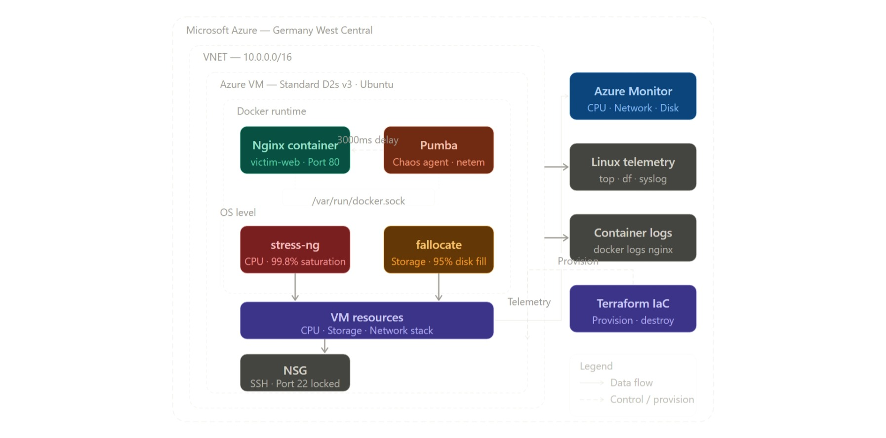
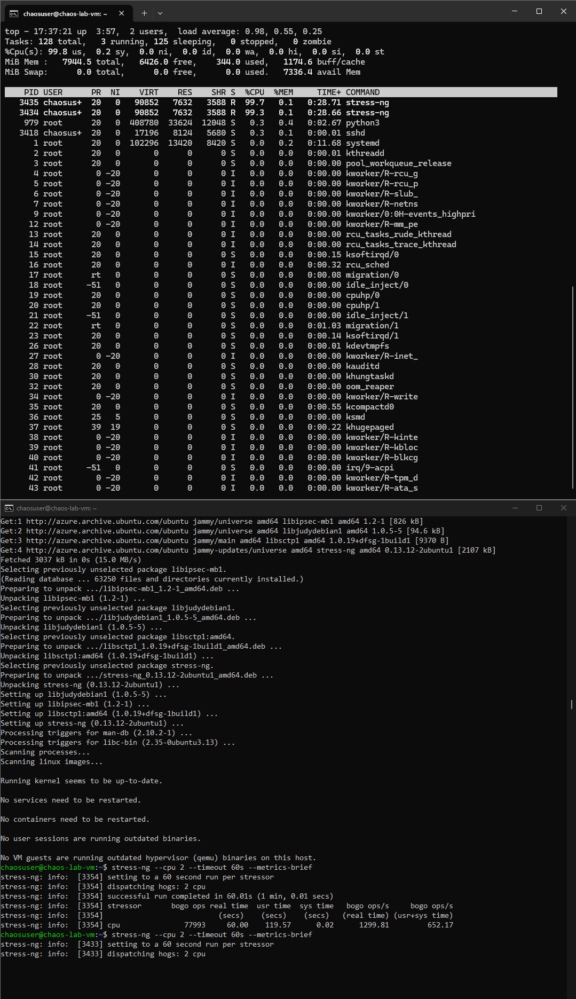

# Chaos Engineering Lab on Azure

I broke a test server on purpose to see how it behaves under three kinds of failure: full CPU, a slow network and a full disk. The Linux VM, its network and firewall rules are created with Terraform; the failures are injected with stress-ng, Pumba and fallocate, and watched in Azure Monitor and with standard Linux tools.

Based on the chaos engineering guide from [mzazon/cloud-projects](https://github.com/mzazon/cloud-projects/tree/main/azure/chaos-engineering-resilience-testing).



## What it does

- Terraform (`code/terraform`) creates a resource group, virtual network, a Network Security Group that allows SSH only from one admin address, a public IP and an Ubuntu VM with key based login.
- `code/scripts/deploy.sh` runs on the VM: it installs stress-ng and Docker, then starts an nginx container (`victim-web`) and pulls Pumba.
- A GitHub Actions workflow checks the Terraform code with `terraform fmt` and `terraform validate`.

## The three experiments

| Failure | Command | What I saw |
|---|---|---|
| CPU at 100% | `stress-ng --cpu 0 --timeout 60s` | `top` showed 99.8% CPU on all cores, the system stayed responsive over SSH |
| Network delay | `docker run --rm -v /var/run/docker.sock:/var/run/docker.sock gaiaadm/pumba netem --duration 60s --delay 3000ms victim-web` | `curl` to the nginx container took about 3 seconds longer for 60 seconds, then went back to normal |
| Full disk | `fallocate -l 25G chaos_disk_hog.img && sleep 60 && rm chaos_disk_hog.img` | `df -h` showed the root disk at 95%, space came back after the file was removed |



## Run it

You need the Azure CLI (`az login`), Terraform and an SSH key pair.

```bash
cd code/terraform
terraform init
terraform apply -var="my_ip=<your public IP>"   # SSH is allowed only from this address; prints the VM IP at the end
scp ../scripts/deploy.sh chaosuser@<vm-ip>:~
ssh chaosuser@<vm-ip> 'bash deploy.sh'
```

Log out and back in after `deploy.sh` so the Docker group change applies, then run the experiments above. Remove everything with `terraform destroy`.

## Problems I ran into

- **`SkuNotAvailable` and no capacity in West Europe.** I changed the region and VM size in Terraform and redeployed. Terraform replaced only what had to change.
- **SSH open to the whole internet by default.** I added an NSG rule that allows port 22 only from my own address.

## What I learned

- Watching a system while it fails tells you which metrics and alerts actually matter.
- How to read `top`, `df -h` and `syslog` during an incident.
- Keeping infrastructure in code makes it cheap to move to another region when one is full.
